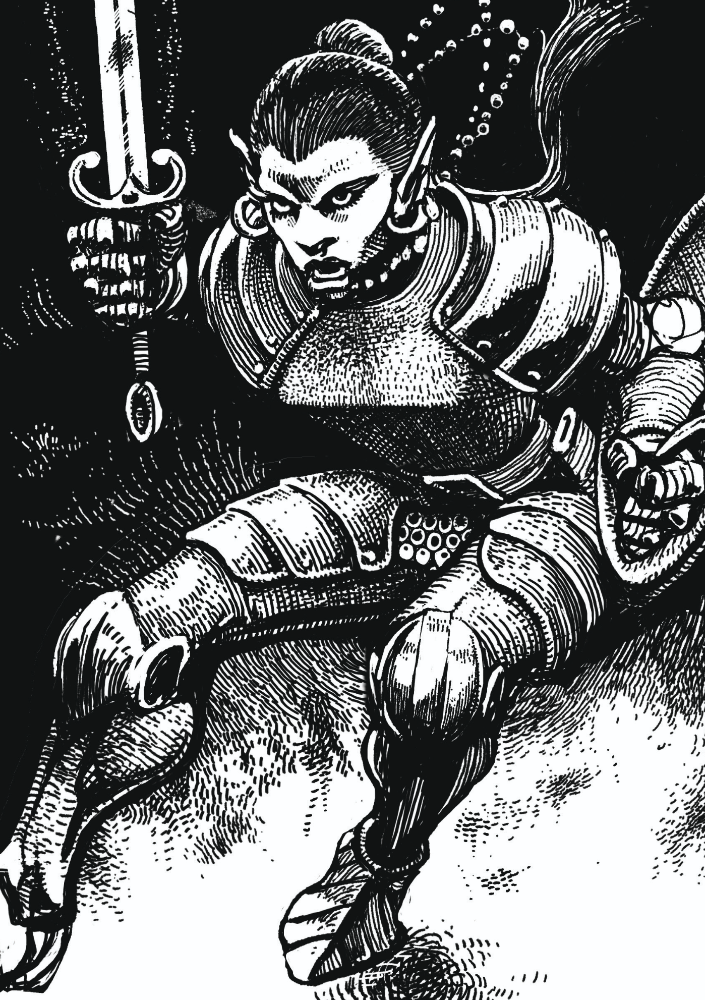

```{=latex}
\onecolumn
```

*Your trusty class handbook for the Old Scrolls roleplaying game.*

```{=latex}
\clearpage
```

{ width=100% }

```{=latex}
\clearpage
```

# Fighter

The classic. This is somebody with some weapon's training, some equipment, and a burning desire to start adventuring with some friends. Their specific training can be as vague or specific as you like. A perfect blank slate to start building a character from.

## Core Fighter Traits

| **Primary Ability**            | Strength                                                                                 |
| ------------------------------ | ---------------------------------------------------------------------------------------- |
| **Hit Points**                 | 14 at 1st level, 10 per level gained after 1st                                           |
| **Saving Throw Proficiencies** | Strength, Constitution                                                                   |
| **Skill Proficiencies**        | Choose any 2 skills. If you choose a skill you already have, you gain expertise with it. |
| **Weapon Proficiencies**       | Choose 4: Blade, Blunt, Bow, Mechanical, Polearm, and Shield                             |
| **Starting Equipment**         | Breastplate or Scale Mail or Chain Mail, Open Helm, Greatsword, Sabre, Large Shield.     |

## Fighter Features

| Level | Proficiency | Class Features                                         |
| ----- | ----------- | ------------------------------------------------------ |
| 1     | +2          | Fighting Style, Gritty Recovery, Weapon Specialization |
| 2     | +2          | Action Surge                                           |
| 3     | +2          | Combat Mastery, Fighter's Talent                       |
| 4     | +2          | Ability Score Improvement                              |
| 5     | +3          | Mighty Warrior                                         |
| 6     | +3          | Ability Score Improvement                              |
| 7     | +3          | Tactical Reflexes                                      |
| 8     | +3          | Ability Score Improvement, Combat Supremacy            |
| 9     | +4          | Indomitable                                            |
| 10    | +4          | Mighty Surge                                           |

```{=latex}
\twocolumn
```

## Fighter Features

As a fighter, you gain the following class features when you reach the specified levels. These features are listed on the Fighter Features table.

## Level 1: Fighting Style

You are trained in one specific style of fighting.

- **Bulwark.** Once per turn when a hostile creature in melee range attempts to move, it must make a Dexterity saving throw (DC 8 + your proficiency bonus + your Strength modifier). If it fails, it cannot move that turn.
- **Berserker.** Once per turn when you drop a target to 0 hit points with an attack, you may make one additional attack.
- **Duelist.** You gain +2 AC while wearing armor that weighs 20 pounds or less and are not using a shield.
- **Guardian.** You gain +1 AC. If a hostile creature in melee range attacks, you may choose its target. You must choose a creature hostile to it, such as yourself.
- **Monster Slayer.** You gain a +2 bonus to damage rolls against creatures that are larger than you.
- **Sharpshooter.** You add double your proficiency bonus to attack rolls with ranged attacks.
- **Stalwart.** You gain a bonus to your maximum hit points equal to your level. While you are at half hit points or less, you regain hit points at the start of your turn equal to your Constitution modifier.
- **Warrior Mage.** You gain a wizard cantrip of your choice and can cast one wizard spell. Each time you gain a level, you can swap those choices for different options. You use the rules for casting spells as per the wizard class.
- **Warrior Mystic.** You gain a mystic cantrip of your choice and can cast one mystic spell. Each time you gain a level, you can swap those choices for different options. You use the rules for casting spells as per the mystic class.

## Level 1: Gritty Recovery

You have an incredible reservoir of durability that carries you through even the most difficult battles. At the start of your turn, you can regain hit points equal to half your maximum hit points.

Once you use this feature, you cannot use it again until you finish a long rest.

## Level 1: Weapon Specialization

Pick a weapon you are proficient with. You add your proficiency bonus to damage rolls with it. After an extended period of downtime, you can swap this choice to a different weapon.

## Level 2: Action Surge

You can push yourself beyond your normal limits for a moment. On your turn, you can take one additional action. Once you use this feature, you can't do so again until you finish a short or long rest.

## Level 3: Combat Mastery

You have a combat mastery die, a d10. You regain expended dice at the start of your turn. You can use a die in the following ways:

- If you miss with an attack, roll the die and add the result to your attack roll. This bonus can turn a miss into a hit.
- If you hit with an attack, roll the die and add the result as a bonus to your damage roll.
- If you are hit by an attack, roll the die and add the result to your AC. This bonus can potentially turn a hit into a miss.

**Action Surge.** When you use Action Surge, you regain all expended combat mastery dice.

## Level 3: Fighter's Talent

Pick a skill that you are proficient with or have expertise with. When you make a check using that skill, you can expend a combat mastery die to augment your check. Roll your combat mastery die and add the result as a bonus to that check. You can use up to one such die per check.

## Level 4: Ability Score Improvement

You gain a +1 bonus to two abilities of your choice.

## Level 5: Mighty Warrior

As an attack action, you can make two weapon attacks.

## Level 6: Ability Score Improvement

You gain a +1 bonus to two abilities of your choice.

## Level 7: Tactical Reflexes

You add your proficiency bonus to initiative rolls. The first time you take a turn after rolling initiative, you may move one additional time.

## Level 8: Ability Score Improvement

You gain a +1 bonus to two abilities of your choice.

## Level 8: Combat Supremacy

You now have two combat mastery dice. Both are d10s. You can apply one or both to a given roll.

## Level 9: Indomitable

When you roll a saving throw or a death save, you can add your level as a bonus to it. You can't use this feature again until you finish a long rest. You can choose to use this benefit after learning if you succeed or fail, potentially turning failure to success.

## Level 10: Mighty Surge

When you use your Action Surge, you gain advantage on all tests you make until your next turn.

```{=latex}
\onecolumn
```

{ width=100% }

```{=latex}
\clearpage
```

*The fighter class handbook.*
