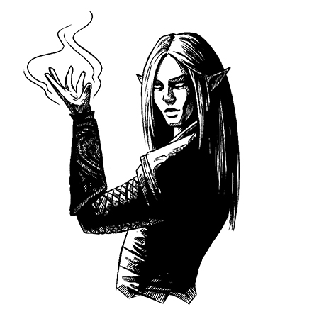
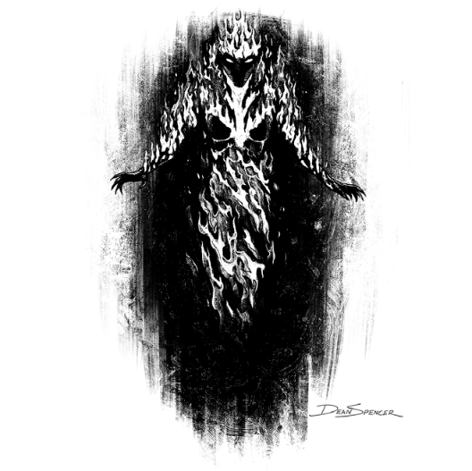
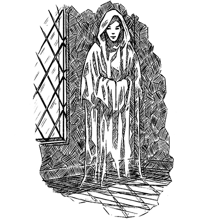

```{=latex}
\onecolumn
```

*Your trusty class handbook for the Old Scrolls roleplaying game.*

```{=latex}
\clearpage
```

{ width=100% }

```{=latex}
\clearpage
```

# Mystic

Mystics draw on strange magics. Where their power comes from is often poorly understood. Some say they draw it from the gods, others say demons, some say the void beyond, some say they draw it from the world itself. Whatever its source, mystics are chiefly concerned with the balance of life and death and see undeath as one of the true evils that needs to be destroyed.

## Core Mystic Traits

| **Primary Ability**            | Wisdom                                                                                   |
| ------------------------------ | ---------------------------------------------------------------------------------------- |
| **Hit Points**                 | 10 at 1st level, 7 per level gained after 1st                                            |
| **Saving Throw Proficiencies** | Wisdom, Charisma                                                                         |
| **Skill Proficiencies**        | Choose any 2 skills. If you choose a skill you already have, you gain expertise with it. |
| **Weapon Proficiencies**       | Choose 2: Blade, Blunt, Bow, Mechanical, Polearm, and Shield                             |
| **Starting Equipment**         | Breastplate, 2 Daggers, Staff, Orb                                                       |

## Mystic Features Table

| Level | Proficiency | Miracles | Spells Prepared | Class Features                    |
| ----: | ----------: | -------: | --------------: | --------------------------------- |
|     1 |          +2 |        2 |               2 | Miracles, Channel Healing, Domain |
|     2 |          +2 |        3 |               3 | Repel Undead                      |
|     3 |          +2 |        3 |               3 | Domain                            |
|     4 |          +2 |        3 |               3 | Ability Score Improvement         |
|     5 |          +3 |        4 |               4 | Mystical Warrior                  |
|     6 |          +3 |        4 |               4 | Mystical Guidance                 |
|     7 |          +3 |        4 |               4 | Domain                            |
|     8 |          +3 |        5 |               5 | Ability Score Improvement         |
|     9 |          +4 |        5 |               5 | Guarded Soul                      |
|    10 |          +4 |        5 |               5 | Boundless Healing                 |

```{=latex}
\twocolumn
```

## Mystic Features

As a mystic, you gain the following class features when you reach the specified levels. These features are listed on the Mystic Features table.

### Level 1: Miracles

You are an initiate into the mysteries of mystical powers, allowing you to call upon them to invoke miracles. Miracles allow you to cast mystical spells and power some of your class features.

**Invoking Miracles.** Miracles are the mystical energy you invoke to cast mystic spells. You start with the ability to invoke two miracles and gain additional ones at levels 2, 5, and 8. You invoke miracles to cast your prepared spells and use some of your class features. Once you invoke a miracle you cannot use it again. You regain one invoked miracle when you finish a short rest and all invoked miracles when you finish a long rest.

**Spellcasting Ability.** Wisdom is the spellcasting ability for mystic spells. If you make an attack roll with a spell, your bonus is your Wisdom modifier plus your proficiency bonus. The saving throw DC of your spells is 8 + your Wisdom modifier + your proficiency bonus.

**Caster Level.** When you cast a spell or use a class feature, its effects might be determined by your level. A spell's level must be less than or equal to your level. Many spells have effects, such as damage, that scale up with your level.

**Spells Prepared.** You start with two spells prepared. You gain additional prepared spells at levels 4, 7, and 10. You can prepare any spell from the mystic spell list, or a spell granted to you by a class feature, with a level less than or equal to your level.

When you finish a long rest, you can replace spells you prepared with different spells of your choice.

**Casting Spells.** To cast a spell, you must invoke a miracle and choose one of your prepared spells to cast. If you have no miracles remaining, you cannot cast a spell unless it does not require a miracle. Cantrips are an exception to this. You can cast a cantrip without invoking a miracle.

### Level 1: Channel Healing

As a magic action, you can invoke a miracle and cause a creature in melee range to regain hit points. You restore 1d8 hit points per level + your spellcasting modifier.

### Level 1: Domain

A domain reflects an area of mystical influence. They are too many domains of mystical influence to name, with each culture having their own list. The domain represents where you believe your power comes from.

The mystic domains are listed at the end of this class description. Each domain provides you with a variety of benefits that reflect the nature of the domain. You gain additional domain benefits at levels 3 and 7.

### Level 2: Repel Undead

As a magic action, you force all undead creatures within 30 feet of you to make a Charisma save (DC 8 + your spellcasting modifier + your proficiency bonus). If a creature fails the saving throw, it is frightened of you. It is no longer frightened after 1 minute, if it takes damage, or if you end your turn more than 120 feet from it. Creatures affected by this feature typically attempt to flee from you to end the effect.

If a creature succeeds the saving throw, it is immune to this class feature for the next hour.

**Invoke Miracle.** You can invoke a miracle when you use this class feature. If you do so, it deals 1d10 radiant damage per level to undead creatures that fail their save, or half damage to creatures that succeed their save. This damage does not end the frightened condition early.

### Level 3: Domain

You gain an additional benefit from your domain.

### Level 4: Ability Score Improvement

You gain a +1 bonus to two abilities of your choice.

### Level 5: Mystical Warrior

As an attack action, you can make two weapon attacks. Alternatively, as a magic attack action you can make a weapon attack and use Channel Healing.

### Level 6: Mystical Guidance

Pick a skill you are proficient with or have expertise with. You add your spellcasting modifier as a bonus to all checks made with that skill.

### Level 7: Domain

You gain an additional benefit from your domain.

### Level 8: Ability Score Improvement

You gain a +1 bonus to two abilities of your choice.

### Level 9: Guarded Soul

As a wielder of miraculous and mystical powers, death must struggle to claim your soul. You die after your fifth failed death save rather than after your third.

### Level 10: Boundless Healing

When you use Channel Healing on a creature, other creatures of your choice within 30 feet of you regain hit points equal to your level.

## Mystic Domains

A domain reflects an area of mystical influence. They are too many domains of mystical influence to name, with each culture having their own list. The domain represents where you believe your power comes from. Your domain shapes your capabilities. A domain sometimes grants spells and cantrips. You always have these spells prepared and cannot replace them. These spells are in addition to the ones you prepare with the Miracles class feature.

### Storm Domain

You are harness the power of nature. The skies above hold power untold. The sky provides nourishing rains and wrathful storms. It is unpredictable and wild.

**Level 1.** You gain the storm strike cantrip.

**Level 3.** You gain the wind step cantrip.

**Level 7.** Once per turn when you damage a hostile creature, up to two creatures of your choice within 30 feet take 2d6 lightning damage.

### Sun Domain

You harness the power of the sun, the giver of life and eternal source of guidance and light for all creatures in the mortal realm. The sun stands watch over the world, casting light that drives away the horrors of the night. As a mystic of the sun, you are charged with protecting your flock from the terrors that lurk in the shadows.

**Level 1.** You gain the radiant strike and light cantrips.

**Level 3.** You gain the light of revelation cantrip.

**Level 7.** Once per turn when you target a hostile creature with an attack or spell, you or a creature of your choice within 30 feet regains 1d6 hit points.

### Moon Domain

You harness the power of the moon, the watcher in the night, the bringer of waves, and a beacon in the darkness. The moon stands watch over the night, the leader amongst the stars, providing guidance to all who are lost.

**Level 1.** As long as you can see the moon and stars, you can never get lost. When you hit a creature with a weapon attack, you can invoke a miracle to inflict 1d10 force damage per level to the creature you hit.

**Level 3.** You add your spellcasting modifier as a bonus to weapon damage rolls. You gain the shape water cantrip.

**Level 7.** You now add double your spellcasting modifier as a bonus to weapon damage rolls.

### Nature Domain

You tap into the primal magic of the wilds and beasts. The plants and animals are diverse and powerful cornerstones of the world, and hold within them mysteries innumerable.

**Level 1.** You gain the speak with animals and entangling vines cantrips.

**Level 3.** You gain the thorny outbreak spell.

**Level 7.** You gain the natural shapeshift spell.

```{=latex}
\onecolumn
```

## Mystic Spell List

The spell list for mystics is organized by level below. The tables are numbered so that you can easily generate random spells of a given level if you so desire.

### Cantrips

| d2  | Spell           |
| --- | --------------- |
| 1   | Mending         |
| 2   | Spare the Dying |

### Level 1 (Tier 1)

| d6  | Spell               |
| --- | ------------------- |
| 1   | Bless               |
| 2   | Doom Foretold       |
| 3   | Mystic Eye          |
| 4   | Protective Ward     |
| 5   | Sacred Redoubt      |
| 6   | Voice of the Mystic |

### Level 3 (Tier 2)

| d6  | Spell           |
| --- | --------------- |
| 1   | Augury          |
| 2   | Grasp of Justice |
| 3   | Revitalize      |
| 4   | Silence         |
| 5   | Spiritual Weapon |
| 6   | Warding Bond    |

### Level 5 (Tier 3)

| d6  | Spell            |
| --- | ---------------- |
| 1   | First Speech     |
| 2   | Glyph of Warding |
| 3   | Hallowed Ground  |
| 5   | Mystical Flare   |
| 4   | Speak with Dead  |
| 6   | Wrathful Host    |

```{=latex}
\clearpage
```

### Level 7 (Tier 4)

| d4  | Spell             |
| --- | ----------------- |
| 1   | Aura of Vitality  |
| 2   | Death Ward        |
| 3   | Divination        |
| 4   | Vengeful Guardian |

### Level 9 (Tier 5)

| d4  | Spell          |
| --- | -------------- |
| 1   | Commune        |
| 2   | Mass Healing   |
| 3   | Mystical Wrath |
| 4   | Revivify       |

```{=latex}
\twocolumn
```

# Mystical Spells

## Augury

**Level:** 3

**Casting Time:** Magic Action

**Range:** Self

**Duration:** Instantaneous

You receive an omen from mystical forces about the results of a course of action that you plan to take within the next 30 minutes. The DM chooses whether to answer weal, woe, or a mix of the two depending on the most likely outcome of the action.

## Bless

**Level:** 1

**Casting Time:** Magic Action

**Range:** 30 feet

**Duration:** Concentration

You bless up to three creatures within range with mystical force. Whenever a target makes an attack roll or a saving throw before the spell ends, the target adds 1d4 to the attack roll or save.

## Commune

**Level:** 9

**Casting Time:** Magic Action

**Range:** Self

**Duration:** Instantaneous

You contact a mystical entity and ask it up to three questions that can be answered with a yes or no. The answer is always correct, but the entity's knowledge may be limited as they are not omniscient. At the DM's option, the entity may demand a service in return for the answer. You can always refuse this request, but if you do so the spell ends. If you accept, you must fulfill the request within one month or you lose one level.

## Death Ward

**Level:** 7

**Casting Time:** Magic Action

**Range:** Touch

**Duration:** 8 hours

You touch a creature. The next time the target would be reduced to 0 hit points, it is instead reduced to 1 hit point and is immune to all damage until its next turn.

## Divination

**Level:** 7

**Casting Time:** Magic Action

**Range:** Self

**Duration:** Instantaneous

As part of casting this spell, you name a location or person you have seen in the past week. If you name a person, you learn their whereabouts at the moment you cast the spell and their general mood or disposition, such as their emotional state. If you name a place, you gain a clear image of its current state including inhabitants. You can see and hear as if you stood in that location, perceiving everything within 60 feet of it for the next round.

## Doom Foretold

**Level:** 1

**Casting Time:** Magic Attack Action

**Range:** 60 feet

**Duration:** 1 round

You intone a dreadful prophecy upon a creature within range, invoking mystical power to twist its fate as punishment for its wrongdoings. The target must make a Wisdom saving throw. On a failed save, it takes 2d6 necrotic damage + 1d6 per level. On a successful save, it takes half damage. Whether the target succeeds or fails, once before your next turn you can grant a bonus to a single attack roll against the target equal to your level.

```{=latex}
\clearpage
```

## Entangling Vines

**Level:** Cantrip (Nature Domain)

**Casting Time:** Magic Action

**Range:** 60 feet

**Duration:** 3 rounds

You cause clinging vines to sprout from a point you choose within range. The vines reach out to grasp anyone within 20 feet of them. The affected area is difficult terrain with a Strength (Athletics) DC equal to 8 + your spellcasting modifier + your proficiency bonus.

**Invoke Miracle.** You can target two different areas.

## First Speech

**Level:** 5

**Casting Time:** Magic Action

**Range:** Touch

**Duration:** 1 hour

Your magic aligns a creature's mind with the primordial speech from which all magic rises, allowing it to communicate with any creature. The creature you touch can understand any spoken or signed language that it hears or sees, and its speech or gestures are understood by any creature that has a language.

## Glyph of Warding

**Level:** 5

**Casting Time:** Magic Action

**Range:** Touch

**Duration:** Until dispelled or triggered

When you cast this spell, you inscribe a glyph that creates a magical effect triggered by other creatures either on a surface or within an object. The glyph can be no bigger than a 10-foot diameter. Choose one of the following effects:

- **Explosive Runes.** The glyph deals 1d8 damage per level of a damage type of your choosing to all creatures that fail a Dexterity saving throw within 20 feet. Creatures take half damage on a successful save.
- **Spell Glyph.** You can store another prepared spell in the glyph. When the glyph is triggered, the spell is cast from the glyph without you needing to use a magic action. You control the casting of the spell as normal, except it comes from the glyph rather than you.

When a creature touches the glyph, you may choose to have it trigger the glyph. You are immediately mentally aware of whenever a creature is within the immediate area of the glyph, no line of sight or other senses required.

## Grasp of Justice

**Level:** 3

**Casting Time:** Magic Attack Action

**Range:** 30 feet

**Duration:** Concentration

Choose a creature within range. The target must succeed on a Wisdom saving throw or become paralyzed for the duration as a shimmering hand of mystical magic (or a claw, or a tentacle, whatever befits your domain) grasps the target. At the end of each of its turns, the target repeats the save, ending the spell on itself on a success.

```{=latex}
\clearpage
```

## Hallowed Ground

**Level:** 5

**Casting Time:** Magic Action

**Range:** Self

**Duration:** Concentration

You channel mystical energy, warding the area around you with protective magic. You and friendly creatures within 20 feet of you gain the following benefits:

- +1 bonus to AC
- Advantage on Constitution saves

Each time you cast a spell or use a feature that allows a creature to regain hit points, you and creatures of your choice within 20 feet of you regain hit points equal to your spellcasting modifier.

## Light

**Level:** Cantrip (Sun Domain)

**Casting Time:** Magic Action

**Range:** Touch

**Duration:** 1 hour

You touch one Large or smaller object that isn't being worn or carried. Until the spell ends, the object sheds dim light in a 20-foot radius. The light can be colored as you like. The spell ends if you cast it again.

## Light of Revelation

**Level:** Cantrip (Sun Domain)

**Casting Time:** Magic Action

**Range:** Self

**Duration:** Concentration

You shed bright sunlight in a 20-foot radius centered on yourself. Undead and fiends treat the area as difficult terrain. If they attempt to enter it, they must make a Wisdom saving throw to do so.

**Invoke Miracle.** As an action on your turn, or as part of the action used to cast this spell, you cause undead and fiends in the spell's area to take 1d6 radiant damage per level.

## Mass Healing

**Level:** 9

**Casting Time:** Magic Action

**Range:** 30 feet

**Duration:** Instantaneous

Creatures of your choice within range regain hit points equal to 1d8 per level + your Wisdom modifier.

## Mending

**Level:** Cantrip

**Casting Time:** Magic Action

**Range:** Touch

**Duration:** Instantaneous

This spell repairs a single break or tear in an object you touch, such as a broken chain link, two halves of a broken key, a torn cloak, or a leaking wineskin. As long as the break or tear is no larger than 1 foot in any dimension, you mend it, leaving no trace of the former damage.

This spell can physically repair a magic item, but it can't restore magic to such an object.

## Mystic Eye

**Level:** 1

**Casting Time:** Magic Action

**Range:** 60 feet

**Duration:** Concentration

You create an invisible sensor at a point you can see within 60 feet. As a magic action for the spell's duration, and as part of casting this spell, you can view the area around that point as if you stood there. You can peer through keyholes, under doors, through cracks, and so on to peer at areas that would otherwise be out of view. The sensor perceives everything within 20 feet of it.

```{=latex}
\clearpage
```

## Mystical Flare

**Level:** 5

**Casting Time:** Magic Attack Action

**Range:** 120 feet

**Duration:** 10 minutes

A blinding flare of light fills a 20-foot-radius sphere centered on a point you choose within range. Each creature in that area must make a Constitution saving throw, with disadvantage if it has darkvision or is undead. On a failed save, a creature takes 1d6 radiant damage per level and is blinded until the end of its next turn. On a successful save, it takes half damage.

The target point continues to shed bright light in a 20-foot radius and dim light in the adjacent 20 feet for the spell's duration.

## Mystical Wrath

**Level:** 9

**Casting Time:** Magic Attack Action

**Range:** 120 feet

**Duration:** Instantaneous

You bring a great mystical power down upon your enemies and a blessing upon your allies. Each hostile creature in a 20-foot-radius sphere centered on a point you choose within range must make a Dexterity saving throw. On a failed save, it takes 1d10 radiant damage per level. On a successful save, it takes half damage. Undead creatures automatically fail this saving throw. Each friendly creature in that area regains 1d10 hit points + your level.

{ width=100% }

{ width=100% }

```{=latex}
\clearpage
```

## Natural Shapeshift

**Level:** 7

**Casting Time:** Magic Action

**Range:** Self

**Duration:** 1 hour

You channel primal magic of nature into your body, adopting the guise of various beasts. Choose one of the forms below. When you transform, any non-metal and non-magic items can meld into your new form. Other items must be dropped.

### Bear

You transform into a bear, granting you the following benefits.

**Size.** You are size Large.

**Abilities.** You gain a +2 bonus to Strength and Constitution.

**AC.** Your AC becomes 14 + your Dexterity modifier.

**Roaring Guardian.** On your turn, you can expend 1 miracle to regain 3d6 + your Wisdom modifier hit points and unleash a primal roar that forces your enemies to focus on you. Hostile creatures in your area are goaded by you for 1 round.

**Bite.** Your bite does 2d6 piercing damage. At level 8, this damage increases to 4d6 piercing.

**Claws.** Your claws do 1d8 slashing damage.

**Multiattack.** As an attack action, you can attack with your bite and claws. At level 5, you can bite once and attack with your claws twice.

### Fish

You transform into a small fish, allowing you to move through water with ease.

**Size.** You are size Tiny.

**AC.** Your AC becomes 18 + your Dexterity modifier.

**Aquatic.** You can swim and can breathe water.

### Rat

You transform into a rat.

**Size.** You are size Tiny.

**AC.** Your AC becomes 16 + your Dexterity modifier.

**Climb.** You can climb.

**Sewer Sneak.** You gain a +4 bonus to Stealth checks.

**Bite.** Your bite does 1d4 piercing damage.

**Multiattack.** As an attack action, you can bite once at level 1, two times at level 3, three times at level 5, and four times at level 8.

### Sparrow

You transform into a sparrow, allowing you to dart through the air.

**Size.** You are size Tiny.

**AC.** Your AC becomes 18 + your Dexterity modifier.

**Flight.** You can fly.

## Protective Ward

**Level:** 1

**Casting Time:** Magic Action

**Range:** Touch

**Duration:** Concentration

Until the spell ends, one willing creature you touch is protected against hostile creatures. The target gains +1 AC and advantage on all saves. The target also can't be charmed or frightened. If the target is already charmed or frightened, that condition ends on it.

```{=latex}
\clearpage
```

## Radiant Strike

**Level:** Cantrip (Sun Domain)

**Casting Time:** Magic Attack Action

**Range:** 5 feet

**Duration:** 1 round

You make a weapon attack against a creature within range. On a hit, the target has disadvantage on attacks against targets other than you on its next turn.

**Invoke Miracle.** When you hit with the attack, the target instead must make a Constitution saving throw. On a failed save, it is blinded. At the end of each of its turns, it repeats the save, ending this effect on a success.

## Revitalize

**Level:** 3

**Casting Time:** Magic Action

**Range:** 5 feet

**Duration:** Instantaneous

Each target regains 1d8 + your Wisdom modifier hit points and you can end one of the following conditions on it: blinded, deafened, or paralyzed.

## Revivify

**Level:** 9

**Casting Time:** Magic Action

**Range:** Touch

**Duration:** Instantaneous

You touch a creature that has died within the last minute. That creature revives with 1 hit point and heals 1 failed death save. This spell cannot reattach lost limbs or a severed head or other extreme wounds that would make revivification impossible.

## Sacred Redoubt

**Level:** 1

**Casting Time:** Magic Action

**Range:** Self

**Duration:** Concentration

You create a redoubt of protective energy in a halo around you that shields your allies from harm. You and friendly creatures within 5 feet of you gain a +1 bonus to AC and cover against ranged attacks.

## Shape Water

**Level:** Cantrip (Moon Domain)

**Casting Time:** Magic Action

**Range:** 30 feet

**Duration:** Instantaneous or 1 hour

You choose an area of water that you can see within range and that fits within a 5-foot cube. You manipulate it in one of the following ways:

- You instantaneously move or otherwise change the flow of the water as you direct, up to 5 feet in any direction. This movement doesn't have enough force to cause damage.
- You cause the water to form into simple shapes and animate at your direction. This change lasts for 1 hour.
- You change the water's color or opacity. The water must be changed in the same way throughout. This change lasts for 1 hour.
- You freeze the water, provided that there are no creatures in it. The water unfreezes in 1 hour.

If you cast this spell multiple times, you can have no more than two of its non-instantaneous effects active at a time, and you can dismiss such an effect as an action.

```{=latex}
\clearpage
```

## Silence

**Level:** 3

**Casting Time:** Magic Action

**Range:** 120 feet

**Duration:** Concentration

No sound can be created within or pass through a 20-foot-radius sphere centered on a point you choose within range. Any creature or object entirely inside the area is immune to thunder damage, and creatures are deafened while entirely inside it. Creatures cannot use magic actions within this area.

## Spare the Dying

**Level:** Cantrip

**Casting Time:** Magic Action

**Range:** 5 feet

**Duration:** Instantaneous

Choose a dying creature within range. The creature regains 1 hit point.

**Level 9.** The range increases to 120 feet.

## Speak with Animals

**Level:** Cantrip (Nature Domain)

**Casting Time:** Magic Action

**Range:** Self

**Duration:** 10 minutes

You can speak and understand the language of all beasts. When attempting to influence a beast, you can opt to use Animal Handling in place of any other skill.

## Speak with Dead

**Level:** 5

**Casting Time:** Magic Action

**Range:** Touch

**Duration:** 10 minutes

You touch a corpse and attempt to commune with its spirit. If its spirit can be contacted, you contact it through mystical means.

Until the spell ends, you can ask the spirit of the corpse up to five questions. The spirit knows only what it knew in life, including the languages it knew. The spirit is under no compulsion to offer a truthful answer if you are antagonistic toward it or it recognizes you as an enemy.

## Spiritual Weapon

**Level:** 3

**Casting Time:** Magic Attack Action

**Range:** 60 feet

**Duration:** Concentration

You create a floating, spectral force that resembles a weapon of your choice, lasting for the duration. The force appears at a point you choose within range, and you can immediately make one melee spell attack against one creature within 5 feet of it. On a hit, the target takes force damage based on your level, see the table below.

Once on each of your later turns, you can move the force up to 30 feet and make another attack with it against a creature within 5 feet of its new location.

| Level 3–4 | Level 5–6 | Level 7–8 | Level 9–10 |
| --- | --- | --- | --- |
| 1d8 | 2d8 | 3d8 | 4d8 |

## Storm Strike

**Level:** Cantrip (Storm Domain)

**Casting Time:** Magic Attack Action

**Range:** 5 feet

**Duration:** Instantaneous

You make a melee attack against a creature within range. On a hit, you can change the weapon's damage to lightning. If you do so, creatures of your choice within 5 feet of you take lightning damage equal to your Wisdom modifier.

**Invoke Miracle.** When you hit with the attack, you can invoke a miracle to increase this cantrip's damage by 1d10 per level.

```{=latex}
\clearpage
```

## Thorny Outbreak

**Level:** 3 (Nature Domain)

**Casting Time:** Magic Action

**Range:** 120 feet

**Duration:** 3 rounds

You cause vines covered with thorns to sprout, filling a 20-foot-radius sphere centered on a point you choose within range. Creatures that enter that area or end their turn there take 1d6 piercing damage.

## Vengeful Guardian

**Level:** 7

**Casting Time:** Magic Action

**Range:** 120 feet

**Duration:** Concentration

Choose a point within range. Once per turn when a hostile creature uses an attack action in a 20-foot-radius sphere centered on that point, it takes 2d6 psychic damage.

## Voice of the Mystic

**Level:** 1

**Casting Time:** Magic Attack Action

**Range:** 60 feet

**Duration:** Instantaneous

You speak a one-word command, lacing it with the power of your mysticism. You can target up to a number of creatures equal to your level. A target must succeed on a Wisdom saving throw or follow the command until the end of its next turn. You can create a one-word command of your choice, though the DM adjudicates the actual effects, or pick the command from these options:

- **Approach.** You pull the target.
- **Fight.** The target uses an attack action on its next turn if a hostile creature is in range.
- **Flee.** You push the target.
- **Grovel.** The target falls prone.
- **Halt.** The target cannot move on its next turn.

## Warding Bond

**Level:** 3

**Casting Time:** Magic Action

**Range:** Touch

**Duration:** Concentration

You touch another willing creature and create a mystic connection between you and the target. While the target is within 20 feet of you, when it takes damage you can instead take that damage.

## Wind Step

**Level:** Cantrip (Storm Domain)

**Casting Time:** Magic Action

**Range:** Self

**Duration:** 1 round

You step through the air, gaining a fly speed until the end of your turn.

**Invoke Miracle.** When you cast this spell, you can invoke a miracle to instead gain a fly speed for 1 minute per level.

## Wrathful Host

**Level:** 5

**Casting Time:** Magic Attack Action

**Range:** Self

**Duration:** Concentration

Wrathful spirits of battle flit in the area near you. At the end of each of your turns for the duration, hostile creatures within 20 feet of you take 2d8 radiant damage.

```{=latex}
\onecolumn
```

{ width=100% }

{ width=100% }

```{=latex}
\clearpage
```

*The mystic class handbook.*
