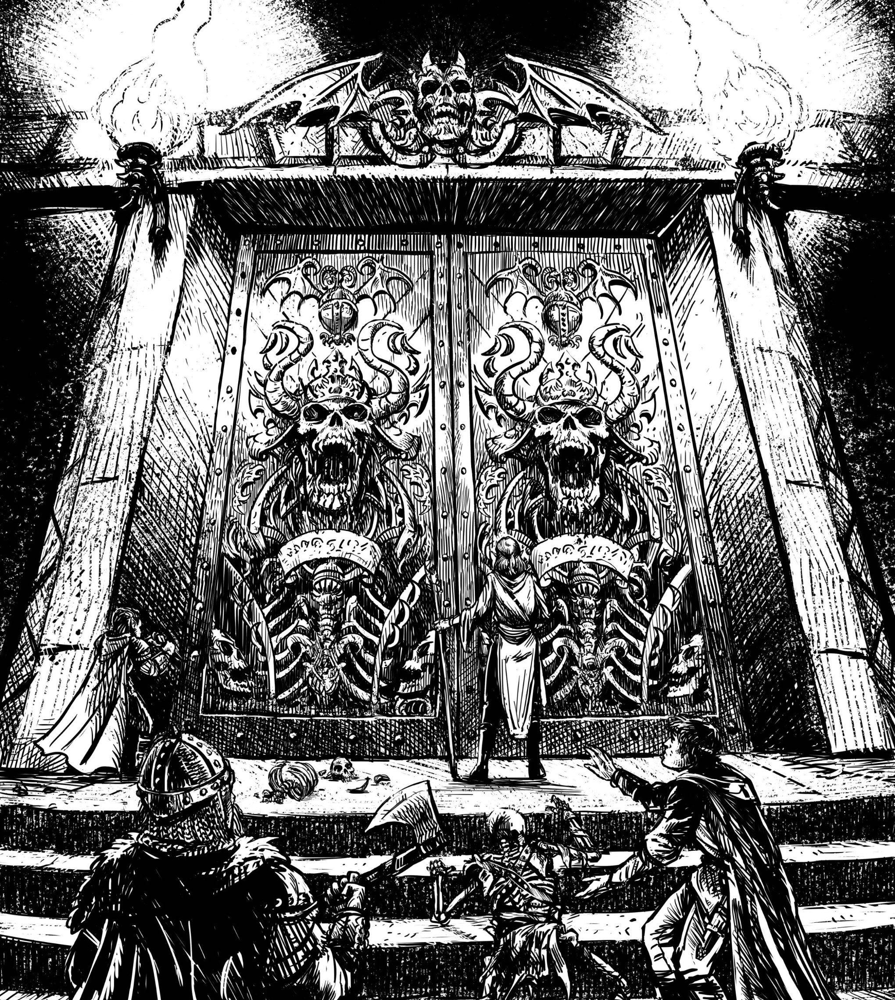
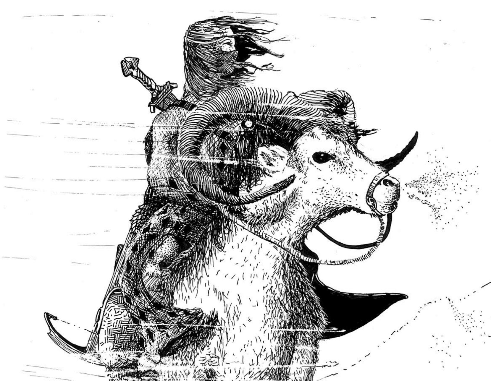

```{=latex}
\onecolumn
```

*Your trusty class handbook for the Old Scrolls roleplaying game.*

```{=latex}
\clearpage
```

{ width=100% }

```{=latex}
\clearpage
```

# Ranger

The ranger is a natural leader, someone who is at home in the wilds and attuned with nature. They have learned how to form strong bonds with the beasts of the wilds, and know how to help their allies in times of need.

## Core Ranger Traits

| **Primary Ability**            | Dexterity                                                                                |
| ------------------------------ | ---------------------------------------------------------------------------------------- |
| **Hit Points**                 | 12 at 1st level, 8 per level gained after 1st                                            |
| **Saving Throw Proficiencies** | Strength, Dexterity                                                                      |
| **Skill Proficiencies**        | Choose any 4 skills. If you choose a skill you already have, you gain expertise with it. |
| **Weapon Proficiencies**       | Choose 3: Blade, Blunt, Bow, Mechanical, Polearm, and Shield                             |
| **Starting Equipment**         | Padded Jacket, Longbow, Sabre, Small Shield, Self-made Map                               |

## Ranger Features Table

| Level | Proficiency | Class Features                             |
| ----- | ----------- | ------------------------------------------ |
| 1     | +2          | Animal Companion, Wildcraft                |
| 2     | +2          | Bounding Movement, Ranger's Guidance       |
| 3     | +2          | Explorer's Talent, Guardian of Nature (d6) |
| 4     | +2          | Ability Score Improvement, Wildcraft       |
| 5     | +3          | Extra Attack, Guardian of Nature (d8)      |
| 6     | +3          | Ability Score Improvement, Wildcraft       |
| 7     | +3          | Companion Talent                           |
| 8     | +3          | Ability Score Improvement, Wildcraft       |
| 9     | +4          | Guardian of Nature (d10)                   |
| 10    | +4          | Boundless Steps                            |

```{=latex}
\twocolumn
```

## Ranger Features

As a ranger, you gain the following class features when you reach the specified levels. These features are listed on the Ranger Features table.

## Level 1: Animal Companion

You gain the services of an animal companion, a beast with a mystic connection to you. You and the beast have an intuitive connection. If you can see or hear each other, you use body language and subtle sounds to communicate as if you shared a language.

The selection of animal companions is provided at the end of the class description. The companion's stats are based on your level.

If your companion dies, you must spend a week wandering the wilds alone to track down and befriend a new companion.

Your companion is effectively a second character you control. It has free will but has chosen to ally with you, but you as a player decide its actions, attitudes, and beliefs. It rolls initiative, takes turns, and otherwise acts independently.

## Level 1: Wildcraft

Your expertise in woodcraft and exploration allows you to hone your skills in combat and as a leader. You gain two wildcraft feats of your choice. When you gain a level, you can swap any wildcraft feat you chose for another.

## Level 2: Bounding Movement

You are agile on your feet and difficult to corner. On your turn, you can move two times.

## Level 2: Ranger's Guidance

When you make a check, you can provide guidance to your allies. Until your next turn, friendly creatures within 30 feet of you can use your result in place of rolling that same check.

## Level 3: Explorer's Talent

You are adept at crafting campsites and finding the perfect place to rest. You can find safe havens in standard wilderness where you can gain the benefits of extended downtime.

## Level 3: Guardian of Nature

You gain a guardian die, a d6 you can use in the following ways once per turn:

- You can roll one die and add it to a damage roll made by you or your animal companion. The die's damage type is one of the roll's types of your choice.
- You can roll one die and add it to a test you or a creature within 30 feet of you makes. You choose to add this die after you learn the test's result, potentially turning failure into a success.

Once you use your guardian die, you can't use it again until your next turn. Your guardian die becomes a d8 at level 5 and a d10 at level 9.

## Level 4: Ability Score Improvement

You gain a +1 bonus to two abilities of your choice.

## Level 4: Wildcraft

You gain a wildcraft feat of your choice. When you gain a level, you can swap any wildcraft feat you chose for another.

## Level 5: Extra Attack

You can attack twice instead of once whenever you take the attack action on your turn.

## Level 6: Ability Score Improvement

You gain a +1 bonus to two abilities of your choice.

## Level 6: Wildcraft

You gain a wildcraft feat of your choice. When you gain a level, you can swap any wildcraft feat you chose for another.

## Level 7: Companion Talent

Your companion gains one of the following benefits. If you gain a new companion, you can pick a new benefit for it to replace the one you chose for your former companion.

- **Iron Hide.** Your companion gains +2 AC.
- **Skilled.** Pick a skill. Your companion doubles its test bonus when making checks that use that skill.
- **Toughness.** While your companion is at half hit points or less, it regains hit points equal to half your level at the end of its turn.
- **Vicious.** Your companion gains a bonus to damage rolls equal to half your level.

## Level 8: Ability Score Improvement

You gain a +1 bonus to two abilities of your choice.

## Level 8: Wildcraft

You gain a wildcraft feat of your choice. When you gain a level, you can swap any wildcraft feat you chose for another.

## Level 10: Boundless Steps

You now can move three times on your turn.

```{=latex}
\onecolumn
```

# Animal Companions

There are three basic companions you can choose from. Animal companions are size Medium beasts unless otherwise noted. Their level equals yours and they share your alignment.

## Bear

The bear is a protector, dedicated to shielding you and your companions from harm. It attacks with a bite and has the following traits.

**Tests.** The bear uses the listed bonus for all tests, except attacks, and Intelligence checks and saves. It uses a +0 bonus for those checks and saves. It uses the listed attack bonus.

**Growling Menace.** The bear goads hostile creatures while they are in melee range of it.

| Level | AC  | HP  | Tests | Attack Bonus | Damage       |
| ----- | --- | --- | ----- | ------------ | ------------ |
| 1     | 14  | 10  | +4    | +5           | 1d6 slashing |
| 2     | 14  | 20  | +4    | +5           | 1d6 slashing |
| 3     | 14  | 25  | +4    | +5           | 2d6 slashing |
| 4     | 14  | 30  | +4    | +5           | 2d6 slashing |
| 5     | 15  | 40  | +5    | +6           | 3d6 slashing |
| 6     | 15  | 45  | +5    | +6           | 3d6 slashing |
| 7     | 15  | 50  | +5    | +6           | 3d6 slashing |
| 8     | 15  | 60  | +5    | +6           | 4d6 slashing |
| 9     | 16  | 65  | +6    | +7           | 4d6 slashing |
| 10    | 16  | 70  | +6    | +7           | 4d6 slashing |

## Eagle

The eagle is a scout, a master of spotting trouble long before it poses a threat. Unlike other companions, the eagle is size Small.

**Tests.** The eagle uses the listed bonus for all tests, except attacks, and Intelligence checks and saves. It uses a +0 bonus for those checks and saves. It uses the listed attack bonus.

**Flying.** The eagle has a fly speed of 40 feet.

**Rapid Flight.** The eagle moves twice on its turn.

| Level | AC  | HP  | Tests | Attack Bonus | Damage        |
| ----- | --- | --- | ----- | ------------ | ------------- |
| 1     | 16  | 6   | +4    | +6           | 1d4 slashing  |
| 2     | 16  | 12  | +4    | +6           | 1d4 slashing  |
| 3     | 16  | 16  | +4    | +6           | 1d10 slashing |
| 4     | 16  | 20  | +4    | +6           | 1d10 slashing |
| 5     | 17  | 25  | +5    | +7           | 2d6 slashing  |
| 6     | 17  | 30  | +5    | +7           | 2d6 slashing  |
| 7     | 17  | 35  | +5    | +7           | 2d6 slashing  |
| 8     | 17  | 40  | +5    | +7           | 3d8 slashing  |
| 9     | 18  | 45  | +6    | +8           | 3d8 slashing  |
| 10    | 18  | 50  | +6    | +8           | 3d8 slashing  |

## Horse

The horse is a trusty companion and mount, the beast of burden that has carried many a hero atop it. Ideal for augmenting your ability rather than fighting on its own.

**Tests.** The wolf uses the listed bonus for all tests, except attacks, and Intelligence checks and saves. It uses a +0 bonus for those checks and saves. It uses the listed attack bonus.

**Mount.** You can ride your horse, if you do, when you roll initiative, you roll with advantage and you and your horse take your turn together.

**Horseback Archer.** You learn to shoot a short bow from horseback. When you do, you deal bonus weapon damage according to the table below.

**Cavalry Charge.** When making a melee weapon attack from horseback, you deal you can force the target to make a Strength saving throw. On a failure, you push them back 10 feet and knock them prone.

| Level | AC  | HP  | Tests | Attack Bonus | Damage          | Bonus Weapon Damage |
| ----- | --- | --- | ----- | ------------ | --------------- | ------------------- |
| 1     | 14  | 10  | +4    | +4           | 1d4 bludgeoning | 1d6                 |
| 2     | 14  | 20  | +4    | +4           | 1d4 bludgeoning | 1d6                 |
| 3     | 14  | 25  | +4    | +4           | 1d6 bludgeoning | 2d6                 |
| 4     | 14  | 30  | +4    | +4           | 1d6 bludgeoning | 2d6                 |
| 5     | 15  | 40  | +5    | +5           | 1d8 bludgeoning | 3d6                 |
| 6     | 15  | 45  | +5    | +5           | 1d8 bludgeoning | 3d6                 |
| 7     | 15  | 50  | +5    | +5           | 2d8 bludgeoning | 3d6                 |
| 8     | 15  | 60  | +5    | +5           | 2d8 bludgeoning | 3d6                 |
| 9     | 16  | 65  | +6    | +6           | 2d8 bludgeoning | 4d6                 |
| 10    | 16  | 70  | +6    | +6           | 3d8 bludgeoning | 4d6                 |

```{=latex}
\clearpage
```

## Wolf

The wolf is a tracker and pack fighter, adept at distracting enemies to allow you to dart in for a deadly attack.

**Tests.** The wolf uses the listed bonus for all tests, except attacks, and Intelligence checks and saves. It uses a +0 bonus for those checks and saves. It uses the listed attack bonus.

**Scent.** The wolf can detect the presence of invisible creatures within 30 feet. It must still find them if they are hidden, but knows they are near. Otherwise, it knows their exact location and can attack them as if it can see them.

**Harrier.** You have advantage on attacks made against creatures in melee range of the wolf.

| Level | AC  | HP  | Tests | Attack Bonus | Damage       |
| ----- | --- | --- | ----- | ------------ | ------------ |
| 1     | 15  | 8   | +5    | +5           | 1d6 piercing |
| 2     | 15  | 16  | +5    | +5           | 1d6 piercing |
| 3     | 15  | 20  | +5    | +5           | 2d6 piercing |
| 4     | 15  | 25  | +5    | +5           | 2d6 piercing |
| 5     | 16  | 30  | +6    | +6           | 3d6 piercing |
| 6     | 16  | 38  | +6    | +6           | 3d6 piercing |
| 7     | 16  | 44  | +6    | +6           | 3d6 piercing |
| 8     | 16  | 50  | +6    | +6           | 4d6 piercing |
| 9     | 17  | 56  | +7    | +7           | 4d6 piercing |
| 10    | 17  | 62  | +7    | +7           | 4d6 piercing |

```{=latex}
\twocolumn
```

# Wildcraft Feats

There are a variety of talents and skills you can choose from to survive in the wilds. Ranger talents focus on combat and dabble in magic, but their most notable ability lies in learning to lead expeditions. You can use the following table to generate choice at random, rerolling duplicates.

| d12 | Wildcraft Feat |
| --- | --- |
| 1 | Ambush Captain |
| 2 | Beast Friend |
| 3 | Combat Sentinel |
| 4 | Druidcraft |
| 5 | Favored Enemy |
| 6 | Lead the Assault |
| 7 | Mountaineer |
| 8 | Relentless Stride |
| 9 | Steely Eyed Shooter |
| 10 | Together We Stand |
| 11 | Tracker |
| 12 | Two-Weapon Expertise |

## Ambush Captain

**Wildcraft Feat (Prerequisite: Wildcraft Feature)**

You and your animal companion can hide in areas of dim light. When you use the hide action, choose up to three creatures within 30 feet of you. They may immediately use the hide action.

## Beast Friend

**Wildcraft Feat (Prerequisite: Wildcraft Feature)**

Your intuitive sense of wild animals allows you to communicate with them with ease. You gain expertise with Animal Handling, or proficiency if you do not yet have it. You can speak and understand the language of beasts.

Your animal companion gains the ability to express itself using gestures, growls, and other actions that effectively allow it to speak Common.

## Combat Sentinel

**Wildcraft Feat (Prerequisite: Wildcraft Feature)**

You and your animal companion can make a Wisdom (Perception) or an Intelligence (Investigation) skill check to thoroughly search something nearby as part of an attack action on your turn.

## Druidcraft

**Wildcraft Feat (Prerequisite: Wildcraft Feature)**

You gain a mystic cantrip of your choice and one mystic spell with a level less than or equal to your level divided by 3 (rounding up). You can choose spells normally limited to the nature domain. When you cast that spell, you cannot cast it again until you finish a long rest. You may change the chosen spell each time you complete a long rest.

You can choose this feat more than once, gaining an additional cantrip and spell.

## Favored Enemy

**Wildcraft Feat (Prerequisite: Wildcraft Feature)**

When you choose this feat, select a creature type such as dragon or humanoid. You gain a favored enemy die. The die is a d6 at levels 1 to 4, a d8 at levels 5 to 8, and a d10 at levels 9 and higher. Once per turn, you can roll that die and add the result as a bonus to a damage roll against the chosen creature type or to a Wisdom (Perception) check made to detect one using the search action.

You can choose this feat more than once, selecting an additional creature type each time.

```{=latex}
\clearpage
```

## Lead the Assault

**Wildcraft Feat (Prerequisite: Wildcraft Feature)**

You, your animal companion, and friendly creatures within 30 feet of you gain advantage on initiative rolls.

## Mountaineer

**Wildcraft Feat (Prerequisite: Wildcraft Feature)**

You and your animal companion gain a climb speed. When you climb a surface, allies within 30 feet of you can also climb that surface as if they had climb speeds until the end of your next turn.

## Relentless Stride

**Wildcraft Feat (Prerequisite: Wildcraft Feature)**

Once on your turn when you move, allies of your choice within 30 feet of you may also move. Your animal companion also gains this benefit.

## Steely Eyed Shooter

**Wildcraft Feat (Prerequisite: Wildcraft Feature)**

You cannot gain disadvantage on ranged attacks, and the targets of your ranged attacks cannot benefit from cover.

When you make a ranged attack against a creature, your animal companion gains advantage on attacks against it on its next turn.

## Together We Stand

**Wildcraft Feat (Prerequisite: Wildcraft Feature)**

You have learned that in the darkest hour, the right words of encouragement are worth more than a king's ransom. As an influence action, a creature of your choice within 30 feet of you regains 1d6 hit points per level + your Charisma modifier. Once you use this feature, you cannot use it again until you finish a short rest.

You and your animal companion gain advantage on tests while a friendly creature is dying within 30 feet of you.

## Tracker

**Wildcraft Feat (Prerequisite: Wildcraft Feature)**

When you use an action to search an area, in addition to the benefits of that action you notice any tracks made in your area within the past day. You learn the direction of travel and the creature type, such as dragon, humanoid, and so on. If your animal companion is in your area when you gain this benefit, you also learn the specific type of creature (orc, owlbear, etc.) and the identity of a creature if you have encountered it before.

## Two-Weapon Expertise

**Wildcraft Feat (Prerequisite: Wildcraft Feature)**

When you use two-weapon fighting as an attack action, choose one of the following benefits:

- You and your animal companion gain +1 AC until your next turn
- You gain a +1 bonus to weapon damage rolls this turn, and your animal companion gains a +2 bonus to damage rolls on its next turn

```{=latex}
\onecolumn
```

{ width=100% }
