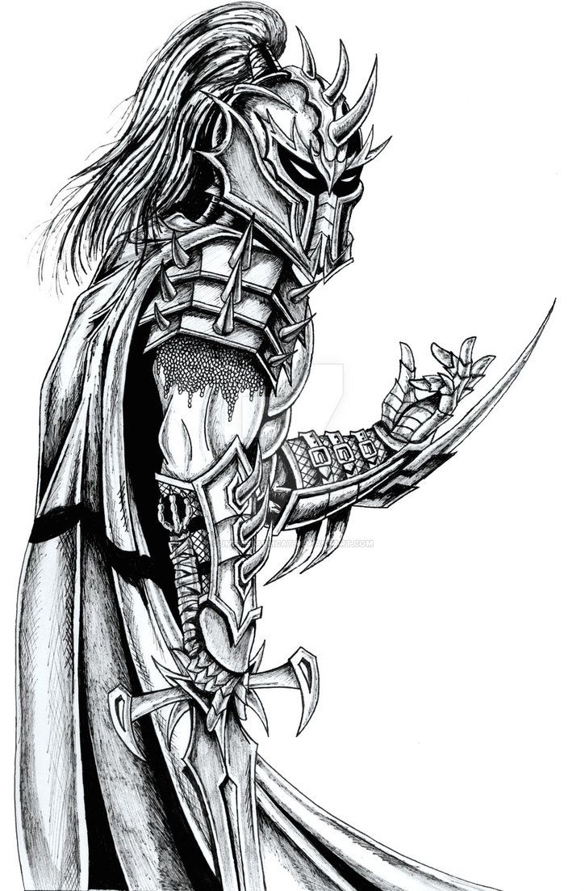
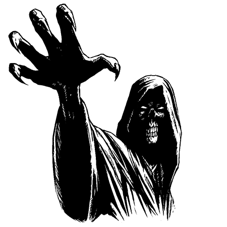

```{=latex}
\onecolumn
```

*Your trusty class handbook for the Old Scrolls roleplaying game.*

```{=latex}
\clearpage
```

{ width=100% }

```{=latex}
\clearpage
```

# Warlock

As a warlock, you have struck pacts with a supernatural entity, a daedra of oblivion, gaining power in return for a variety of promises and oaths. The stronger your soul and ability to convince your patron, the greater your powers.

## Core Warlock Traits

| **Primary Ability**            | Charisma                                                                                 |
| ------------------------------ | ---------------------------------------------------------------------------------------- |
| **Hit Points**                 | 10 at 1st level, 7 per level gained after 1st                                            |
| **Saving Throw Proficiencies** | Wisdom, Charisma                                                                         |
| **Skill Proficiencies**        | Choose any 2 skills. If you choose a skill you already have, you gain expertise with it. |
| **Weapon Proficiencies**       | Choose 1: Blade, Blunt, Bow, Mechanical, Polearm, and Shield                             |
| **Starting Equipment**         | Padded Jacket, Sabre, Light Crossbow                                                     |

## Warlock Features Table

| Level | Proficiency | Power | Class Features |
| --- | --- | --- | --- |
| 1 | +2 | 1 | Pact Magic, Warlock Gift |
| 2 | +2 | 1 | Warlock Gift |
| 3 | +2 | 2 | Familiar |
| 4 | +2 | 2 | Ability Score Improvement, Warlock Gift |
| 5 | +3 | 3 | Bargain of Fate |
| 6 | +3 | 3 | Warlock Gift |
| 7 | +3 | 4 | Superior Familiar |
| 8 | +3 | 4 | Ability Score Improvement, Warlock Gift |
| 9 | +4 | 5 | Deft Arcana |
| 10 | +4 | 5 | Pact Forger, Warlock Gift |

```{=latex}
\twocolumn
```

## Warlock Features

As a warlock, you gain the following class features when you reach the specified levels. These features are listed on the Warlock Features table.

## Level 1: Pact Magic

You have struck a variety of pacts to gain access to magical powers.

**Gifts.** You master warlock gifts, magical abilities you can use at-will that grow in power as you gain levels. Charisma is your spellcasting ability for your warlock features. If you make an attack roll with a warlock feature, your bonus is your Charisma modifier plus your proficiency bonus. The saving throw DC of your warlock class features is 8 + your Charisma modifier + your proficiency bonus. These benefits also apply to your gifts. If a warlock gift grants you a weapon, you are proficient with it and use your Charisma modifier to modify its attack and damage rolls rather than the ability the weapon normally uses. The weapon is one-handed unless otherwise noted.

**Power.** As you gain levels, you grow more adept at using your gifts. Some effects refer to your power to reflect their greater strength as you gain levels. The power column gives this information for each level.

## Level 1: Warlock Gift

You gain two warlock gifts of your choice. You gain an additional gift at levels 2, 4, 6, 8, and 10.

## Level 2: Warlock Gift

You gain a warlock gift of your choice.

## Level 3: Familiar

You gain the services of a familiar, an supernatural entity that obeys your orders but also surreptitiously spies on you on behalf of the entities you have sworn pacts with.

Choose a familiar from the options provided below. The familiar's stats are based on your level. If your familiar dies, a new one of the same type appears the next time you finish a long rest.

Your familiar is effectively a second character you control. It has free will, but you as a player decide its actions, attitudes, and beliefs. However, the familiar reports back all your actions to the various entities you have created pacts with, potentially sparking trouble for you.

## Level 4: Ability Score Improvement

You gain a +1 bonus to two abilities of your choice.

## Level 4: Warlock Gift

You gain a warlock gift of your choice.

## Level 5: Bargain of Fate

You have studied many strange entities and crafted deals with unimaginable powers. When your soul wavers on the edge of death, you gain strange insights into the world as your patrons warp fate to ensure your continued utility. You gain a bonus to all tests equal to your number of failed death saves.

## Level 6: Warlock Gift

You gain a warlock gift of your choice.

## Level 7: Superior Familiar

Your familiar gains an additional feature, as detailed in its description.

## Level 8: Ability Score Improvement

You gain a +1 bonus to two abilities of your choice.

## Level 8: Warlock Gift

You gain a warlock gift of your choice.

## Level 9: Deft Arcana

As an action on your turn, you use two of your gifts that require an action to use. However, only one of those gifts can require an attack action.

## Level 10: Pact Forger

You have unraveled the secrets needed to strike pacts with other creatures. Pick one of your warlock gifts and touch a creature as a magic action. That creature gains the benefits of that gift, using its Charisma to determine its effects as per the Pact Magic class feature. This benefit lasts for one hour. Once you use it, you cannot use it again until you finish a long rest.

Once while a creature benefits from your pact, you can issue it an edict. The edict is a command of up to 13 words that it must fulfill before the benefit provided by this feature ends. If it fails to do so, it gains a failed death save.

Alternatively, in place of issuing an edict you can demand that the creature share its life force with you. The next time you gain a failed death save before this feature's duration ends, this creature instead gains it.

## Level 10: Warlock Gift

You gain a warlock gift of your choice.

```{=latex}
\clearpage
```

# Warlock Gifts

Here are the core Warlock Gift feats you can choose from. Some gifts allow you to create objects. Unless otherwise noted you can dismiss such objects on your turn without using an action. The object disappears when it is no longer in your possession.

Most gifts list benefits at various tiers. Unless a benefit at a higher power upgrades or explicitly replaces one of a lower tier, you gain the benefit of your current power and all lower ones.

Use the table below to pick gifts at random, rerolling results of 14 or higher.

| d20 | Result |
| --- | --- |
| 1 | Cat's Blessing |
| 2 | Devouring Blade |
| 3 | Echo of the Tower Impenetrable |
| 4 | Emerald Serpent of the Warding Way |
| 5 | Gift of the Deep |
| 6 | Hammer of the Cosmos |
| 7 | Language of the Dead |
| 8 | Shard of a Stolen Star |
| 9 | Step of Hidden Ways |
| 10 | Storm Heart |
| 11 | Walker in Shadows |
| 12 | Wind of the Far Traveler |
| 13 | Words of the First Pact |
| 14+ | Roll again |

## Cat's Blessing

**Warlock Gift Feat (Prerequisite: Warlock Gift Feature)**

Your patron has taken powers from a former pact bearer who was a catfolk. As a token of appreciation for your services, you have earned this gift. At power 1 you gain darkvision. At power 3, you can see through magical darkness. At power 5, you can see invisible creatures and objects within 30 feet of you.

## Devouring Blade

**Warlock Gift Feat (Prerequisite: Warlock Gift Feature)**

As a magic action, you conjure a long blade from another realm. It appears to be crafted from the bones of an ancient predator, the beast's teeth forming a serrated edge. The blade is a one-handed melee weapon. When you hit a hostile creature with the blade, you regain hit points equal to your power. It does 1d6 piercing damage + 1d6 per power.

On the turn you create this weapon, you can use an attack action to attack with it without using an action.

## Echo of the Tower Impenetrable

**Warlock Gift Feat (Prerequisite: Warlock Gift Feature)**

Legend holds that a great tower sits at the center of the universe, an indestructible edifice that holds trapped within it utter nothingness that would annihilate the universe if it escaped. You have deciphered an echo of the unbreakable iron used to craft the tower, granting you superior durability. Your AC is 11 + your power + your Dexterity modifier.

## Emerald Serpent of the Warding Way

**Warlock Gift Feat (Prerequisite: Warlock Gift Feature)**

As a magic action, you create a bright, green serpent that wraps around your arm and extends its long, sinuous body around your shoulders, granting you the benefits of wielding a shield. As an attack action you can command the serpent to strike a creature in melee range. You make a melee attack against the target. The snake does 1d8 poison damage per power + your Charisma modifier.

On the turn you create this weapon, you can use an attack action to attack with it without using an action.

## Gift of the Deep

**Warlock Gift Feat (Prerequisite: Warlock Gift Feature)**

You have learned the secrets of the kraken or some other creature of the depths. At power 1 you gain a swim speed. At power 3 you can breathe underwater. At power 5 as a magic action you can grant the power 1 and 3 benefits to a creature in melee range for 24 hours.

## Hammer of the Cosmos

**Warlock Gift Feat (Prerequisite: Warlock Gift Feature)**

You have stolen a shard of the hammer used to forge the cosmos. As an attack action you can project a bolt of force as a ranged attack against a target within 120 feet that does 1d8 force damage per power + your Charisma modifier and pushes the target on a hit.

## Language of the Dead

**Warlock Gift Feat (Prerequisite: Warlock Gift Feature)**

You have learned the secrets of the barrier between the realm of the living and the dead, allowing you to speak to spirits caught between them. You can understand the speech of any dead or undead creature. At power 1 you roll 1d4 and add the result to any checks you make as part of the influence action involving undead or dead creatures. At power 3 you can converse with creatures that have died within the past year. At power 5 you can converse with creatures that have died within the past century.

## Shard of a Stolen Star

**Warlock Gift Feat (Prerequisite: Warlock Gift Feature)**

As a magic action, you conjure a mace from another realm crafted from an otherworldly metal. Its crushing head is an impossibly heavy, utterly black chunk of a star. It is a two-handed melee weapon. You can wield the shard as a weapon. It does 1d6 force damage + 1d6 per power + your Charisma modifier. As part of the attack action before choosing the target of your attack, you can attempt to pull a creature within 30 feet. It must make a Strength save to avoid being pulled.

On the turn you create this weapon, you can use an attack action to attack with it without using an action.

## Step of Hidden Ways

**Warlock Gift Feat (Prerequisite: Warlock Gift Feature)**

You gained access to a map that details the underlying firmament architecture of all creation, allowing you to cross a distance in the blink of an eye. As a magic action you can teleport to a spot you can see, with the distance determined by your power. The range of this teleport is a number of 30 feet at power 1 and increases by 30 feet at every additional power.

## Storm Heart

**Warlock Gift Feat (Prerequisite: Warlock Gift Feature)**

Your patron holds the secrets to the powers of lightning storms, and has granted you a semblance of their power. You gain resistance to lightning damage. As an attack action, you can fire a lightning bolt as a ranged weapon attack. Each bolt does 1d10 + your Charisma modifier lightning damage. At power 3 you fire two bolts. At power 5 you fire three bolts.

## Walker in Shadows

**Warlock Gift Feat (Prerequisite: Warlock Gift Feature)**

You have learned secrets that allow you to step into the space between spaces, making it easy for you to avoid detection. At power 1 when you make a Stealth check you roll 1d4 and add it to your result. At power 3 you can use the hide action once on your turn without using an action. At power 5 you can use a magic action to turn invisible for the next minute or until you use an attack or magic action.

## Wind of the Far Traveler

**Warlock Gift Feat (Prerequisite: Warlock Gift Feature)**

Your patron stole a wind that blew in the first storm to sweep across the world and has granted you access to some of its power. It slides and whirls around your feet at all times. At power 1 you take no damage from falling and gain a climb speed. At power 3, as a magic action you can move as if you had a fly speed until the end of the turn, at which point you fall to the ground if you are still in midair. At power 5, you gain a fly speed.

## Words of the First Pact

**Warlock Gift Feat (Prerequisite: Warlock Gift Feature)**

Your patron has captured an echo of the first deal made between two gods which they grant you knowledge of. At power 1 and higher whenever you make a Persuasion check roll 1d4 and add it to the result. At power 3, as a magic action you can pick a creature within 30 feet. It must make a Charisma save or it is charmed by you for the next minute or until it takes damage. At power 5, you can use your power 3 benefit against up to 5 creatures.

If a creature succeeds the save against this feature, it cannot be targeted with it again for one hour.

```{=latex}
\onecolumn
```

# Familiars

A familiar's level is equal to yours.

## Golden Saint

This creature appears as a golden skinned and armored elf-like being. Golden saints are known to serve their lords loyally within a harsh warrior caste system. It can choose to sprout white, feathery wings at will, giving an almost angelic appearance. It is size Medium.

**Tests.** The saint uses the listed bonus for all tests, except attacks. It uses the listed attack bonus.

**Fluttering Wings.** The saint has a fly speed of 30 feet.

**Radiant Beam.** The saint has a ranged attack with a range of 120 feet.

**Superior Talents.** The saint doubles its test bonus when making a Wisdom (Insight) or Wisdom (Medicine) check. It can cast the light cantrip.

**Superior Familiar – Soothing Aura.** As an action, the saint can cause a creature within 30 feet to regain 1d6 + your level hit points. It cannot use this feature again until it completes a short or long rest.

| Level | AC | HP | Tests | Attack Bonus | Damage |
| --- | --- | --- | --- | --- | --- |
| 3 | 14 | 10 | +4 | +5 | 1d4 radiant |
| 4 | 14 | 12 | +4 | +5 | 1d4 radiant |
| 5 | 15 | 14 | +5 | +6 | 1d4 radiant |
| 6 | 15 | 16 | +5 | +6 | 1d4 radiant |
| 7 | 15 | 18 | +5 | +6 | 1d6 radiant |
| 8 | 15 | 20 | +5 | +6 | 1d6 radiant |
| 9 | 16 | 22 | +6 | +7 | 1d8 radiant |
| 10 | 16 | 24 | +6 | +7 | 1d8 radiant |

## Scamp of Debts

The devious scamp is charged by their daedric lord to watch over those who owe their liege significant debts. It ensures that its charge remains intact enough to pay off what they owe. It is size Small.

**Tests.** The scamp uses the listed bonus for all tests, except attacks, and Strength checks and saves. It uses a +0 bonus for those checks and saves. It uses the listed attack bonus.

**Fiery Blast.** The scamp has a ranged attack with a range of 120 feet. It can use its fiery touch to ignite flammable material such as wood or cloth.

**Superior Talents.** The scamp doubles its test bonus when making a Charisma (Deception) or Wisdom (Perception) check.

**Superior Familiar – Diabolic Spy.** As an action, the scamp can turn invisible for up to 10 minutes. This effect ends if it uses an attack or magic action.

```{=latex}
\clearpage
```

| Level | AC | HP | Tests | Attack Bonus | Damage |
| --- | --- | --- | --- | --- | --- |
| 3 | 14 | 10 | +4 | +5 | 1d4 fire |
| 4 | 14 | 12 | +4 | +5 | 1d4 fire |
| 5 | 15 | 14 | +5 | +6 | 1d4 fire |
| 6 | 15 | 16 | +5 | +6 | 1d4 fire |
| 7 | 15 | 18 | +5 | +6 | 1d6 fire |
| 8 | 15 | 20 | +5 | +6 | 1d6 fire |
| 9 | 16 | 22 | +6 | +7 | 1d8 fire |
| 10 | 16 | 24 | +6 | +7 | 1d8 fire |

## Seeker

The horrifying seeker has a face of grotesque tentacles, four eyes, four limbs, a toothy maw in its chest, and tattered robes surrounding it. It has no legs and levitates above the ground instead. It seeks forbidden knowledge for its mysterious lord and communicates exclusively telepathically. It is size Medium.

**Tests.** The seeker uses the listed bonus for all tests, except attacks, and Strength checks and saves. It uses a +0 bonus for those checks and saves. It uses the listed attack bonus.

**Levitation.** The seeker has a fly speed of 30 feet.

**Psychic Blast.** The seeker has a ranged attack with a range of 120 feet.

**Superior Talents.** The twilight doubles its test bonus when making an Intelligence (Arcana) or Intelligence (Investigation) check.

**Superior Familiar – Keen Senses.** The twilight can see invisible creatures and objects in its area. It can communicate telepathically with any intelligent creature.

| Level | AC  | HP  | Tests | Attack Bonus | Damage      |
| ----- | --- | --- | ----- | ------------ | ----------- |
| 3     | 14  | 10  | +4    | +5           | 1d4 psychic |
| 4     | 14  | 12  | +4    | +5           | 1d4 psychic |
| 5     | 15  | 14  | +5    | +6           | 1d4 psychic |
| 6     | 15  | 16  | +5    | +6           | 1d4 psychic |
| 7     | 15  | 18  | +5    | +6           | 1d6 psychic |
| 8     | 15  | 20  | +5    | +6           | 1d6 psychic |
| 9     | 16  | 22  | +6    | +7           | 1d8 psychic |
| 10    | 16  | 24  | +6    | +7           | 1d8 psychic |

```{=latex}
\onecolumn
```

{ width=100% }
