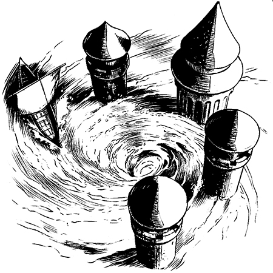

# Illusionist

## Core Illusionist Traits

| **Primary Ability**            | Wisdom                             |
| ------------------------------ | ---------------------------------- |
| **Hit Points**                 | 1d6                                |
| **Saving Throw Proficiencies** | Wisdom, Charisma                   |
| **Skill Proficiencies**        | Choose 3 skills                    |
| **Weapon Proficiencies**       | Choose 1 category                  |
| **Starting Equipment**         | Padded Jacket, Dagger, Cloak, Wand |

## Illusionist Features

| Level | Proficiency | Class Features |
| ----- | ----------- | -------------- |
| 1     | +2          | Spellcasting   |
| 2     | +2          | —              |
| 3     | +2          | Ability Bonus  |
| 4     | +2          | —              |
| 5     | +2          | Illusory Copy  |
| 6     | +2          | —              |
| 7     | +2          | Ability Bonus  |
| 8     | +2          | —              |
| 9     | +3          | —              |
| 10    | +3          | —              |

## Level 1: Spellcasting

You can cast spells from the Illusionist spell list. Wisdom is your casting ability. You know two cantrips.

You prepare a number of spells equal to your total number of spell slots. You may change your prepared spells after an extended period of downtime.

You regain all expended spell slots when you finish a long rest. Once per day, you may regain 1 expended spell slot when you finish a short rest.

## Spell Slots by Level

| Level | 1 | 2 | 3 |
| ----- | - | - | - |
| 1     | 1 | – | – |
| 2     | 2 | – | – |
| 3     | 2 | – | – |
| 4     | 3 | – | – |
| 5     | 4 | 1 | – |
| 6     | 4 | 2 | – |
| 7     | 4 | 2 | – |
| 8     | 4 | 3 | – |
| 9     | 4 | 3 | 1 |
| 10    | 4 | 3 | 2 |

## Level 3: Ability Bonus

You gain a +1 bonus to two different abilities of your choice.

## Level 5: Illusory Copy

As an action, you can create a perfect visual illusion of yourself at a point you can see within 30 feet. The illusion is intangible. It lasts for 1 minute but it ends early if you dismiss it or fall unconscious. The illusion is animated and mimics your expressions and gestures. While it persists, you gain the following benefits.

**Cast Spells**. You can cast spells as though you were in the illusion's space, but you must use your own senses.

**Distract**. When both you and your illusion are within 5 feet of a creature that can see the illusion, you have advantage on attack rolls against that creature, given how distracting the illusion is to the target.

**Move**. Once per turn, you can move the illusion up to 30 feet to an unoccupied space you can see that is within 120 feet of yourself.

## Level 7: Ability Bonus

You gain a +1 bonus to two different abilities of your choice.

## Illusionist Spells

The tables are numbered to allow quick generation of spells known for a new character.

### Cantrips

| d4 | Cantrip |
| -- | ------- |
| 1  | Chromatic Flare |
| 2  | Light |
| 3  | Minor Illusion |
| 4  | Prestidigitation |

### Level 1 Spells

| d6  | Level 1          |
| --- | ---------------- |
| 1   | Audible Glamor   |
| 2   | Color Spray      |
| 3   | Disguise Self    |
| 4   | Hypnotism        |
| 5   | Phantasmal Force |
| 6   | Wall of Fog      |

### Level 2 Spells

| d6 | Level 2 |
| -- | ------- |
| 1  | Darkness |
| 2  | Hypnotic Pattern |
| 3  | Improved Phantasmal Force |
| 4  | Invisibility |
| 5  | Mirror Image |
| 6  | Misty Step |

### Level 3 Spells

| d6 | Level 3 |
| -- | ------- |
| 1  | Dispel Magic |
| 2  | Fear |
| 3  | Greater Invisibility |
| 4  | Hallucinatory Terrain |
| 5  | Rope Trick |
| 6  | Spectral Force |

# Illusionist Spell List

Spells descriptions are listed below.

---

## Audible Glamor

**Level:** 1

**Range:** 120 feet

A cacophony of distracting sounds erupts from a point in range. Each creature in a 15-foot radius sphere centered on that point makes a Wisdom saving throw. If a creature fails the save, attacks against it have advantage for 1 round.

---

## Chromatic Flare

**Level:** Cantrip

**Range:** 120 feet

You send a bolt of scintillating, chromatic energy at a foe. Make a ranged attack against the target. On a hit, the target takes 1d8 radiant damage and you are invisible to it for 1d3 rounds.

The damage increases to 2d8 radiant damage at level 5 and 3d8 radiant damage at level 9.

---

## Color Spray

**Level:** 1

**Range:** Self

Waves of chromatic energy erupt from your outstretched hands, dazzling creatures before you. Each creature in a 15-foot cone projected from you makes a Wisdom saving throw, taking 2d6 radiant damage on a failed save or half damage on a successful one.

If a creature fails the save, it is blinded for 1 round.

---

## Darkness

**Level:** 2

**Range:** 60 feet

**Duration:** Concentration, up to 10 minutes

Darkness spreads from a point within range and fills a 15-foot-radius sphere.

Darkvision can't see through it, and nonmagical light can't illuminate it. Magical sources of light created by level 2 or lower spells shed no light in this area.

---

## Disguise Self

**Level:** 1

**Range:** Self

**Duration:** 1 hour

You make yourself, including your belongings, look different. You can seem 1 foot shorter or taller and can appear heavier or lighter.

The changes wrought by this spell fail to hold up to physical inspection.

An observer can notice this is an illusion with a successful Intelligence (Investigation) check against your spell save DC.

---

## Dispel Magic

**Level:** 3

**Range:** 120 feet

Choose one creature, object, or magical effect within range. Any ongoing spell of level 3 or lower on the target ends. For each ongoing spell of level 4 or higher on the target, make an ability check using your spellcasting ability (DC 10 plus that spell's level). On a successful check, the spell ends.

---

## Fear

**Level:** 3

**Range:** Self

**Duration:** Concentration, up to 1 minute

Each creature in a 30-foot cone projected from you must succeed on a Wisdom saving throw or drop whatever it is holding and become frightened of you for the duration.

If the creature ends its turn in a space where it doesn't have line of sight to you, the creature makes a Wisdom saving throw. On a successful save, the spell ends on that creature.

---

## Greater Invisibility

**Level:** 3

**Range:** 10 feet

**Duration:** Concentration, up to 1 hour

Creatures of your choice within range become invisible. The spell ends early immediately after the target makes an attack roll, deals damage, or casts a spell.

---

## Hallucinatory Terrain

**Level:** 3

**Range:** Self

**Duration:** Concentration, up to 1 minute

You can create illusory, static objects such as pillars, trees, walls, and other terrain features within 30 feet of yourself. Each object can occupy a space up to 10 feet on each side. You can pass through these objects but cannot see through them. Other creatures treat them as solid. A creature can use its action to inspect an object. It makes a Wisdom saving throw. If it succeeds, it too can move through them.

---

## Hypnotic Pattern

**Level:** 2

**Range:** Self

**Duration:** Concentration, up to 1 minute

The colors of your clothes, gear, and body flash and swirl, hypnotizing anything that looks at you. If a creature targets you with an attack, spell, or other effect, it must immediately make a Wisdom save. If it fails, its turn immediately ends, and the triggering effect does not occur.

---

## Hypnotism

**Level:** 1

**Range:** 60 feet

**Duration:** Concentration, up to 1 minute

Choose a creature that you can see within range. The target must succeed on a Wisdom saving throw or enter a dreamlike trance. For the duration of the spell, it answers your questions truthfully and with perfect recall. It can attempt to avoid answering with a successful Wisdom save. If it saves, the spell ends. The target has advantage on the save if this spell is cast during combat, and the duration immediately ends if it takes damage. It can otherwise act normally.

---

## Improved Phantasmal Force

**Level:** 2

**Range:** 60 feet

**Duration:** Up to 10 minutes

You create the illusion of a creature with the stats listed below and an appearance of your choice. The illusion acts as you wish. Each time it takes damage, you must make a Charisma save. If you fail, the spell ends early. Otherwise, reduce the damage to 0.

The force is incapable of moving objects, opening doors, and so on. The damage from its attacks reflects psychic distress.

>**Improved Phantasmal Force**
>*Level 3 Large Construct, Unaligned*
>
>**AC:** 15
>
>**HP:** 20
>
>**Tests:** +0
>
>**Spd:** 40
>
>**XP:** 0
>
>**Initiative 20: Phantasmal Strike.** Melee attack, +4 to hit. 2d6 psychic damage, and the target is either goaded for 1 round or it is pushed 10 feet.

---

## Invisibility

**Level:** 2

**Range:** Touch

**Duration:** Concentration, up to 1 hour

A creature you touch becomes invisible. The spell ends early immediately after the target makes an attack roll, deals damage, or casts a spell.

If you cast this spell with a level 3 slot, you can target two creatures.

---

## Light

**Level:** Cantrip

**Range:** Touch

**Duration:** 1 hour

An object you touch sheds dim light in a 30-foot radius and Dim Light for an additional 20 feet. The spell ends if you cast it again.

---

## Minor Illusion

**Level:** Cantrip

**Range:** 30 feet

**Duration:** 1 minute

You create a sound or an image of an object within range that lasts for the duration. See the descriptions below for the effects of each. The illusion ends if you cast this spell again.

A creature can determine that it is an illusion with a successful Intelligence (Investigation) check against your spell save DC.

**Sound.** If you create a sound, its volume can range from a whisper to a scream that can last up to the spell's duration.

**Image.** An image you create cannot be larger than a 5-foot cube or a size Medium creature. The image can't create sound, light, smell, or any other sensory effect. Physical interaction with the image reveals it to be an illusion.

---

## Mirror Image

**Level:** 2

**Range:** Self

**Duration:** 1 minute

Three illusory duplicates of yourself appear in your space. The duplicates move with you and mimic your actions, shifting position so it's impossible to track which image is real.

Each time a creature hits you with an attack roll during the spell's duration, roll a d6 for each of your remaining duplicates. If any of the d6s rolls a 3 or higher, one of the duplicates is hit instead of you, and the duplicate is destroyed. The duplicates otherwise ignore all other damage and effects. The spell ends when all three duplicates are destroyed.

A creature is unaffected by this spell if it cannot see or can use other senses to pinpoint you.

---

## Misty Step

**Level:** 2

**Range:** Self

Briefly surrounded by silvery mist, you teleport up to 30 feet to an unoccupied space you can see. Casting this spell does not use your action.

<!-- pagebreak -->

---

## Phantasmal Force

**Level:** 1

**Range:** 60 feet

**Duration:** Up to 10 minutes

You create the illusion of a creature with the stats listed below and an appearance of your choice. The illusion acts as you wish. Each time it takes damage, you must make a Charisma save. If you fail, the spell ends early. Otherwise, reduce the damage to 0.

The force is incapable of moving objects, opening doors, and so on. The damage from its attacks reflects psychic distress.

>**Phantasmal Force**
>*Level 1 Medium Construct, Unaligned*
>
>**AC:** 14
>
>**HP:** 8
>
>**Tests:** +0
>
>**Spd:** 30
>
>**XP:** 0
>
>**Skirmisher.** Can dash without using an action.
>
>**Initiative 20: Phantasmal Strike.** Melee attack, +4 to hit. 1d10 psychic damage.

---

## Prestidigitation

**Level:** Cantrip

**Range:** 10 feet

**Duration:** Up to 1 hour

You create a minor magical effect within range. You can light a torch, create a glowing sigil, clean off an object, or create an object that can fit in the palm of your hand. An object created in this manner is an obvious, worthless duplicate. The spell ends if you cast it again.

---

## Rope Trick

**Level:** 3

**Range:** Self

**Duration:** 15 minutes

You conjure a rope that extends up to 30 feet above you. At the top of the rope forms a flat, invisible platform up to 20 feet long and wide. A creature standing on the platform is invisible. The rope is anchored to the platform and turns invisible if it is pulled up onto it.

Creatures on the platform remain invisible until they take damage or target a hostile creature with a spell or effect. If one creature does so, the platform no longer grants invisibility.

<!-- pagebreak -->

---

## Spectral Force

**Level:** 3

**Range:** 60 feet

**Duration:** Up to 10 minutes

You create the illusion of a creature with the stats listed below and an appearance of your choice. When you create the illusion, you can choose for it to be invisible until it attacks. The illusion acts as you wish. Each time it takes damage, you must make a Charisma save. If you fail, the spell ends early. Otherwise, reduce the damage to 0.

The force is incapable of moving objects, opening doors, and so on. The damage from its attacks reflects psychic distress.

>**Spectral Force**
>*Level 5 Medium Construct, Unaligned*
>
>**AC:** 16
>
>**HP:** 30
>
>**Tests:** +2
>
>**Spd:** 40 ft., fly
>
>**XP:** 0
>
>**Initiative 20: Phantasmal Strike.** Melee attack, +6 to hit. 2d8 psychic damage, and the target is either goaded or frightened until after its next turn.

---

## Wall of Fog

**Level:** 1

**Range:** 120 feet

**Duration:** 10 minutes

You create a thick, billowing wall of fog that blocks sight and sound. It is one-foot thick, 10 feet high, and up to 30 feet long. The wall can bend and turn as you wish, but all of it must be within the spell's range when you create it.

<!-- pagebreak -->

```{=latex}
\onecolumn
```

{ width=90%}
